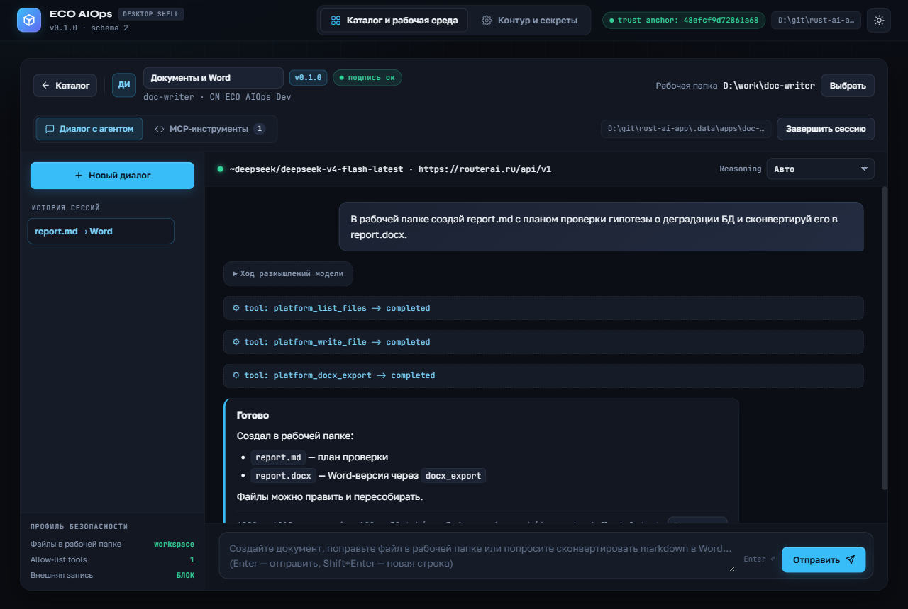
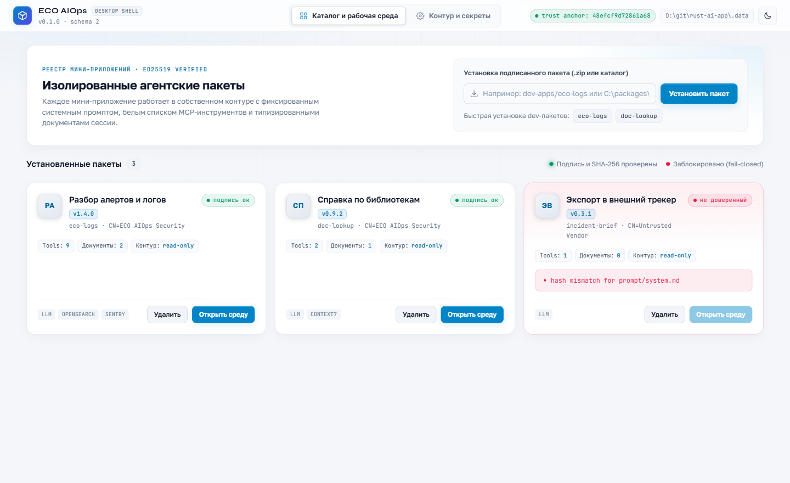

# ECO AIOps Platform

Desktop-платформа для мини-приложений на базе ИИ-агентов. Пользователь ставит одно
Windows-приложение и устанавливает в него подписанные пакеты: у каждого свой системный
промпт, скилы, подключения и инструменты. Агентский движок — [opencode](https://opencode.ai)
sidecar, интерфейс — Tauri v2 + WebView2.

> Статус: рабочий прототип, не production. Инсталляторы и dev-подпись есть; нет
> production-сертификата Authenticode, проверки на чистой машине и песочницы
> процессов. Полный список — в `HANDOFF.md` §6 и §11.

Релизы (снимки исходников для проверки): [github.com/neyara11/rust-ai-app/releases](https://github.com/neyara11/rust-ai-app/releases).



Каталог подписанных пакетов:



## Возможности

- **Подписанные пакеты.** Ed25519-подпись `manifest.json`, sha256 файлов, проверка при
  установке и при каждом запуске. Любая проблема — отказ (fail-closed).
- **Реестр приложений.** Установка из папки и `.zip`, удаление, переключатель приложений,
  отображение версии и подписанта.
- **Рабочая папка.** У каждого приложения своя папка, которую выбирает пользователь.
  Агент читает и пишет только внутри неё.
- **Шлюз инструментов.** opencode видит один MCP-сервер `platform`: файловые инструменты,
  exe-инструменты из пакета и remote MCP. Allow-list, лимит ответа 64 КиБ, аудит.
- **Демо `doc-writer`.** Агент создаёт markdown в рабочей папке и конвертирует его в
  Word через `docx-export.exe` из самого пакета.
- **Демо `office-writer`.** Word и Excel из одной рабочей папки: чтение готовых
  `.docx`/`.xlsx`, экспорт с картинками, нативные графики Excel и офлайн-рендер
  Mermaid/Chart в PNG без браузера.
- **MCP.** Streamable HTTP + SSE, токены в DPAPI, ручной вызов из UI. Один id может
  иметь разные URL/токены/TLS-политику в разных приложениях; переопределения задаются
  во вкладке «Настройки приложения».
- **Секреты.** DPAPI (per-user), в конфиг и логи не попадают. Для инструментов можно
  задать значения глобально или отдельно для приложения; app-override приоритетнее.
- **Private CA.** Для LLM-шлюза и MCP есть отдельные переключатели отключения проверки
  TLS-сертификата и имени хоста — только для закрытого контура и с явным предупреждением.
- **Чат.** Оболочка в духе design-next: единый сайдбар с карточкой агента, поиском и
  историей по датам (сегодня/вчера/на неделе), переименование сессии, сворачивание в
  рельс (Ctrl+B) и быстрый поиск (Ctrl+K); live-стриминг reasoning/текста через SSE,
  уровни reasoning, статистика ответов, стек уведомлений.
- **Рендер ответов.** GFM-таблицы, блоки кода с языком, кнопкой «Копировать» и
  офлайн-подсветкой (highlight.js + PowerShell), ссылки `http(s)`/`mailto`, которые
  открываются системным обработчиком, а не внутри webview. Упоминания файлов рабочей
  папки превращаются в чипы: открыть, показать в папке, сохранить копию.
- **Подтверждения инструментов.** Для записи и запуска кода по умолчанию спрашивается
  разрешение: разово, на текущий чат или постоянно для пакета. Постоянное разрешение
  привязано к версии пакета, рабочей папке и хешу бинаря; любое действие пишется в
  аудит, разрешение можно отозвать. Инструмент с бинарём пакета всегда считается
  запуском кода, даже если манифест объявил его записью.
- **Схемы и графики.** Mermaid и Chart.js работают офлайн из локальных vendor-файлов;
  есть исходник, сохранение SVG/PNG через системный диалог и явные ошибки рендера.
- **Вложения.** Файл можно выбрать, перетащить в область чата или вставить из буфера
  (изображение/текст); лимиты и проверка возможностей модели сохраняются.
- **Закрытый UI.** Шрифты и JS лежат в бандле, CSP ограничивает источники; UI-smoke
  падает при любом внешнем запросе.
- **Версии.** Проверка `min_shell_version`, запрет downgrade, архив предыдущих версий,
  управляемый откат (`--rollback`/кнопка в UI) и сравнение пакета с установленной
  версией (`--check`).
- **Доверие и allowlist.** Machine-scope anchor с ротацией до 4 ключей
  (`--trust`/`--untrust`), подписанный allowlist/CRL с версиями, `revoked` и TTL;
  проверка при установке, запуске и откате.
- **Локальный и корпоративный режимы.** Локальный ставит любые пакеты и держит
  неизменность через подпись или локальный seal; корпоративный требует anchor,
  allowlist и управляемый контур. Роль разработчика открывает мастер пакета.
- **Группа скилов.** Пакет может содержать несколько `skills/<name>/SKILL.md` с
  ресурсами; модель загружает нужный скил через `platform_skill`, а не получает все
  тексты сразу. `bin`-инструментов может быть несколько.
- **Переупаковщик агентов.** `dev-apps/agent-repacker` — мини-приложение на файловых
  инструментах: раскладывает `source/` (`AGENTS.md`, скилы, скрипты, MCP) в пакет
  схемы 2, пишет манифест, JSON-адаптеры, `SECRETS_REQUIRED.md`, `REPORT.md` и
  `build.ps1`. Компиляцию exe и `eco-pack validate/build` выполняет автор снаружи.
- **Незавершённые ходы.** Переключение приложения не закрывает движок: ход
  продолжается в фоне, старые чаты переименовываются из первого сообщения.
- **Артефакты.** Крупные tool-результаты пишутся в NDJSON по сессиям с квотами и
  TTL; есть `--artifacts`, `--grep-artifacts` и команда `artifact_grep`.

Полный процесс разработки, тестирования, подписи ИБ и тиражирования —
`docs/APP_LIFECYCLE.md`.

## Архитектура

```
┌────────────────────────────────────────────────────────────────────┐
│ Tauri v2 shell (Rust) + WebView2                                   │
│  ├─ реестр подписанных пакетов                                     │
│  ├─ UI: каталог, чат, инструменты, настройки (design-next shell)    │
│  └─ stdio MCP gateway (--mcp-proxy app workspace)                   │
└───────────────┬───────────────────────────────┬────────────────────┘
                │ stdio                         │ HTTP
                ▼                               ▼
        opencode sidecar                 LLM gateway
        ├─ file tools / package exe      (OpenAI-compatible)
        └─ remote MCP (опционально)
```

Инварианты:

- агент не общается с инструментами напрямую — только через шлюз;
- приложения изолированы по пакетам, рабочим папкам и подключениям;
- пакет не может расширить свои права — только разработчик при выпуске новой версии.

## Быстрый старт (dev)

Требования: Windows 10/11, Rust/MSVC, Node.js (чтобы поставить opencode в
`tools/oc`), WebView2. Python нужен только для пересборки `docx-export.exe`.
Собранному дистрибутиву Node/npm/Python не нужны.

```powershell
$env:ECO_PLATFORM_HOME="D:\git\rust-ai-app\.data"   # профиль разработки
cargo run --manifest-path src-tauri/Cargo.toml
```

Если профиль не задан, данные идут в `%LOCALAPPDATA%\EcoAIOps`.

Окружение выбирается при установке (NSIS-диалог), записывается в
`%ProgramData%\EcoAIOps\install-mode.json` и после этого не переключается из приложения:

- **Локальный** — можно ставить любые пакеты (подписанные и без подписи); установленное
  приложение менять нельзя (подпись или локальный seal). Anchor и allowlist не нужны.
- **Корпоративный** — только пакеты с подписью доверенного ключа и разрешением allowlist.

Тихая установка: `setup.exe /S /MODE=local` (или `/MODE=corporate`).
Режим разработчика включается без переустановки: Настройки → «Включить режим
разработчика» или `eco-platform.exe --role developer`.
Для профилей без установки (разработка) режим задаётся вручную:

```powershell
& $exe --mode local user          # или: --mode corporate developer
```

Подробно — `docs/LOCAL_AND_CORPORATE.md`.

Установка trust anchor и демо-пакетов (корпоративный контур):

```powershell
$exe = "src-tauri\target\debug\eco-platform.exe"
& $exe --trust dev\keys\trusted.pub   # debug/dev: пишет в профиль
& $exe --install dev-apps\doc-writer
& $exe --install dev-apps\doc-lookup
& $exe --anchor                       # источник anchor и отпечаток
```

Release-сборка принимает anchor только machine-wide:
`HKLM\SOFTWARE\EcoAIOps\TrustedPub` (ставить из-под администратора; GPO/установщик).
Пользовательский anchor действует только при `ECO_PLATFORM_DEV=1` или в debug-сборке.

Ротация ключей: до 4 активных anchor; `--trust <new.pub>` добавляет ключ,
`--untrust <fingerprint|public-key|all> [--force]` убирает (последний ключ — только
с `--force`). Пакет принимается, если подпись совпала хотя бы с одним активным ключом.

Подписанный allowlist (необязателен): `%ProgramData%\EcoAIOps\allowlist.json` +
`allowlist.sig` (в dev — `<home>\allowlist.json`; `ECO_ALLOWLIST_PATH` работает
только в debug-сборке). Пока файла нет, действует только проверка подписи пакета;
если файл есть и валиден, разрешены только перечисленные `app_id`/версии, а
`revoked` блокирует запуск. Битый, неподписанный или просроченный документ блокирует
установку/запуск (fail-closed); статус `incomplete` означает, что доставлен
`allowlist.json` без `.sig` — сначала кладите подпись. Пример —
`dev/allowlist.example.json`, проверка — `--allowlist`, `--allowlist-verify`,
`--allowlist-check`.

Движок ищется в `ECO_OPENCODE_BIN`, затем в `<home>\engine\opencode.exe`, затем в
`tools\oc\node_modules\opencode-ai\bin\opencode.exe` (dev-путь).

## Мини-приложение `doc-writer`

1. Откройте приложение и выберите рабочую папку в шапке (кнопка «Выбрать»).
2. Напишите агенту, например: «Создай `report.md` с планом проверки и сконвертируй в
   `report.docx`».
3. Агент вызовет `write_file` и `docx_export`; оба файла появятся в рабочей папке.

Конвертер — часть подписанного пакета:

```
dev-apps/doc-writer/
  bin/docx-export.exe      # Python-скрипт, собранный PyInstaller
  manifest.json            # tools[].bin + sha256 exe
  manifest.sig
  prompt/system.md
  skills/doc-workflow/SKILL.md
```

Исходник и сборка конвертера:

```powershell
cd tools\docx-export
.\build.ps1                 # соберёт и скопирует exe в dev-apps/doc-writer/bin
```

Пересборка, обновление `hashes`, подпись и установка — одной командой:

```powershell
powershell -File tools\package.ps1              # exe -> hashes -> sign -> --verify -> --install
powershell -File tools\package.ps1 -SkipConverter   # только hashes/sign/verify/install
```

Ключ `-Wheelhouse <dir>` передаёт офлайн-зависимости в сборку конвертера, `-NoInstall`
оставляет только сборку и проверку пакета. Для закрытого контура см.
`tools/docx-export/README.md`.

## Мини-приложение `office-writer`

Word, Excel и схемы в одном пакете. Office-файлы читаются из рабочей папки:
пользователь копирует туда `.docx`/`.xlsx`, агент вызывает `read_office`, получает
markdown с картинками, затем собирает результат через `docx_export` или
`xlsx_export`. Графики и схемы рендерятся офлайн в PNG (`chart` → `charts-rs`,
`mermaid` → `merman`), без Chromium, Node и интернета.

```
dev-apps/office-writer/
  bin/office-kit.exe       # read_office, docx_export, xlsx_export (PyInstaller)
  bin/diagram-render.exe   # render_chart, render_mermaid (Rust)
  manifest.json
  manifest.sig
  prompt/system.md
  skills/diagrams/SKILL.md
  skills/office-format/SKILL.md
```

Сборка обоих бинарников и подпись пакета:

```powershell
powershell -ExecutionPolicy Bypass -File tools\office-kit\build.ps1
powershell -ExecutionPolicy Bypass -File tools\diagram-render\build.ps1
powershell -ExecutionPolicy Bypass -File tools\package.ps1 -App office-writer -SkipConverter -NoInstall
```

Офлайн-проверка инструментов без LLM:

```powershell
powershell -ExecutionPolicy Bypass -File tools\e2e-office.ps1
```

Ограничения: только `.docx`/`.xlsx` (без legacy `.doc`/`.xls`), вложения Office в
чате не поддерживаются — файл должен лежать в рабочей папке, пиксельного паритета
с превью чата нет.

## Упаковка мини-приложения (`eco-pack`)

`eco-pack` — офлайн-утилита для авторов мини-приложений: один exe, без Rust/Node/Python
и без сети.

```powershell
eco-pack init D:\apps\my-app --app-id my-app --name "My App"
eco-pack validate D:\apps\my-app
eco-pack build D:\apps\my-app -o D:\out\my-app.zip   # пересчитывает hashes и пакует zip
eco-pack keygen --out D:\keys\me
eco-pack dev-install D:\apps\my-app `
  --key D:\keys\me\dev.key --pub D:\keys\me\trusted.pub `
  --profile D:\work\eco-dev-me --platform "C:\Program Files\ECO AIOps\eco-platform.exe"
```

- `validate` до первого `build` падает: файлы ещё не покрыты `hashes`.
- Пример исходников с навыком и работой с файлами — `examples/file-notes`,
  минимальный набор без манифеста — `examples/skill-only`; требования к исходникам —
  `docs/MINIAPP_AUTHORING.md`. Переупаковка готового агента с MCP и `.env` —
  `docs/REPACK_AGENT.md`; тестирование без готовых ключей — `docs/CLOSED_CONTOUR_TEST.md`.
  Мастер пакета умеет собрать `manifest.json` из
  `AGENTS.md` и навыка, писать манифест вручную не обязательно.
- В платформе есть вкладка **«Мастер пакета»**: создание каркаса, редактирование
  `manifest.json`/`prompt/**`/`skills/**`, `validate`, `build`, dev-подпись и
  установка в профиль. MCP-подключения объявляются в манифесте по id (URL, токен и
  TLS-политика — в «Настройках → Реестр MCP-серверов» или в «Настройках приложения»,
  DPAPI); мастер находит `.mcp.json`, `mcp.json`, `.vscode/mcp.json`,
  `opencode.json(c)` и умеет включать запись.
  Она вызывает тот же `eco-pack.exe` (ищется в `ECO_PACK_BIN`,
  `<profile>\pack`, рядом с платформой, `tools\pack\target\*`, `vendor\pack`).
- `dev-install` подписывает пакет dev-ключом, кладёт anchor в указанный dev-профиль и
  ставит пакет через установленную платформу (`ECO_PLATFORM_DEV=1`). Machine-anchor
  prod-машины имеет приоритет, поэтому там dev-install не пройдёт.
- Сборка самой утилиты (команда платформы): `powershell -File tools\build-pack.ps1`
  → `vendor/pack/eco-pack.exe` (подписывается dev-сертификатом, если он есть).

## Сборка дистрибутива

```powershell
powershell -File tools\vendor.ps1     # vendor/engine + сверка с tools/engine.lock.json
powershell -File tools\build-pack.ps1 # vendor/pack/eco-pack.exe
powershell -File tools\build-installer.ps1 -Trust   # сборка + dev-подпись (self-signed)
```

`build-installer.ps1` сам вызывает `vendor.ps1` и `build-pack.ps1`
(`-SkipVendor`/`-SkipPack` отключают шаги). Для `cargo tauri build` нужен Tauri CLI 2
(`cargo install tauri-cli --version "^2"`).

- `bundle.active: true`; `vendor/engine` попадает в `engine/` рядом с
  `eco-platform.exe`, `vendor/pack` — в `pack/` (`eco-pack.exe` доступен мастеру
  пакета из установленной платформы).
- Движок не ходит в сеть и не требует npm: включены
  `OPENCODE_DISABLE_MODELS_FETCH`/`..._DEFAULT_PLUGINS`/`..._LSP_DOWNLOAD`, а
  провайдер `@ai-sdk/openai-compatible` встроен в бинарь opencode.
- Порядок поиска движка: `ECO_OPENCODE_BIN` → `<home>/engine/opencode.exe` →
  `engine/opencode.exe` рядом с платформой → `tools/oc` (dev).
- Для полностью офлайн-сборки нужны кеши Tauri
  `%LOCALAPPDATA%\tauri\{NSIS,WixTools314,x64}` (в `x64` — bootstrapper WebView2);
  вместо `offlineInstaller` можно указать `fixedRuntime` с папкой рантайма.
- Результат: NSIS-установщик `ECO AIOps_0.4.3_x64-setup.exe` ~280 МБ в
  `src-tauri/target/release/bundle/nsis/`. `bundle.targets` — `["nsis"]`;
  MSI в релиз не собирается.
- Подпись Authenticode для dev-сборки:
  `powershell -File tools\build-installer.ps1 -Trust` создаёт self-signed
  code-signing сертификат `CN=ECO AIOps Dev` в `Cert:\CurrentUser\My`, подписывает
  `eco-platform.exe` и NSIS (SHA-256). `-Trust` добавляет сертификат в
  `CurrentUser\Root` и `TrustedPublisher`, иначе статус будет `UntrustedRoot`.
  Для поставки подписывать сертификатом УЦ: `-Thumbprint <sha1>` (или свой
  `signCommand` для HSM/токена). Self-signed сертификат — только для dev.

## Файловые инструменты

Доступны пакету с `capabilities.file_scopes: ["workspace"]`:

| Инструмент | Назначение |
|---|---|
| `list_files` | список файлов и папок в рабочей папке |
| `read_file` | чтение UTF-8 файла (≤ 64 КиБ) |
| `write_file` | создание/перезапись (≤ 1 МиБ) |
| `append_file` | дописать в конец |
| `docx_export` | exe из пакета: markdown → `.docx` |

Пути только относительные. Абсолютные пути, `..` и выход за папку (включая symlink)
отклоняются после канонизации.

## CLI

```text
--verify <package>          проверить подпись и хеши
--install <package>         установить пакет (downgrade отклоняется)
--check <package>           сравнить версию пакета с установленной
--mode <local|corporate> [developer|user]  выбрать окружение и роль
--role <developer|user>     переключить роль без смены окружения
--history <app>             сохранённые версии для отката
--rollback <app> [version]  явный откат к сохранённой версии (в аудит)
--list                      список установленных пакетов
--trust <trusted.pub>       добавить trust anchor (release: только с админом)
--untrust <fp|pub|all>      убрать активный anchor (последний — с --force)
--anchor                    anchors, отпечатки, allowlist, dev/elevated
--allowlist                 статус разрешённого списка
--allowlist-verify <file>   проверить подпись allowlist перед раскаткой
--allowlist-check <app> [ver]  решение allowlist для установки/запуска
--artifacts <app>           квоты и NDJSON-дампы сессий
--grep-artifacts <app> <query> [session]  поиск по дампам
--secret-add <name> <v>     сохранить секрет в DPAPI
--import-auth <name> <json> <provider>
--mcp-probe <url>
--mcp-call <url> <tool> <json>
--mcp-add <id> <url> [token]
--mcp-call-app <app> <server> <tool> <json>
--chat <app> <text> [low|medium|high]
--chat-async <app> <text>
--chat-sessions <app>
--system-prompt <app>       показать точный системный промпт движка,
                            включая сгенерированный список инструментов платформы
--artifact-tool <app> <tool> [json|-]
                            выполнить platform-инструмент тем же путём, что и агент
                            (`artifact_list`, `artifact_search`, `artifact_read`);
                            `-` читает JSON-аргументы из stdin
```

Пример сквозной проверки:

```powershell
$env:ECO_PLATFORM_HOME="D:\git\rust-ai-app\.data"
.\src-tauri\target\debug\eco-platform.exe --chat-async doc-writer `
  "Создай note.md и сконвертируй в note.docx"
```

## Тесты

```powershell
cargo test --manifest-path src-tauri/Cargo.toml
```

Покрыты подпись/хеши/схема, версии и downgrade, path traversal, file tools, разбор
MCP (JSON/SSE), лимит ответа, endpoint, allowlist (версии/revoked/TTL/подписи),
ротация нескольких anchor, ремонт старых заголовков чатов, накопление live-элементов
при смене assistant-сообщения и квоты/grep NDJSON-дампов.

E2E и UI-прогоны:

```powershell
powershell -ExecutionPolicy Bypass -File tools\e2e-docx.ps1   # реальный LLM
cd tools\ui-smoke; npm install; npm test                        # mock UI
```

## Карта репозитория

| Путь | Что там |
|---|---|
| `src-tauri/src/` | платформа: реестр, шлюз, движок, секреты, аудит, команды |
| `src/` | статический UI без npm-сборки |
| `dev-apps/` | подписанные пакеты-примеры: `doc-writer`, `doc-lookup`, `agent-repacker` |
| `tools/signer/` | genkey / sign / verify пакетов |
| `tools/package.ps1` | сборка/подпись/установка пакета одной командой |
| `tools/pack/` | `eco-pack`: офлайн-упаковка мини-приложений для авторов |
| `tools/build-pack.ps1` | сборка и Authenticode-подпись `eco-pack.exe` |
| `tools/vendor.ps1` | вендоринг движка в `vendor/engine` с проверкой `tools/engine.lock.json` |
| `tools/engine.lock.json` | пин движка: точная версия opencode и sha256 бинаря/моделей |
| `tools/docx-export/` | исходник конвертера и PyInstaller-сборка |
| `tools/stub-llm/` | локальная заглушка OpenAI-совместимого API |
| `tools/e2e-docx.ps1` | e2e: реальный агент создаёт markdown и конвертирует в `.docx` |
| `tools/ui-smoke/` | Playwright-прогон UI на встроенном browser-mock |
| `HANDOFF.md` | состояние, ограничения и backlog для следующего агента |
| `docs/ROADMAP_CURRENT.md` | актуальный roadmap: что сделано, что осталось, приоритеты |
| `docs/ROADMAP.md` | исходный план (исторический) |
| `docs/APP_LIFECYCLE.md` | как разрабатывать, тестировать, подписывать и тиражировать мини-приложения |
| `docs/LOCAL_AND_CORPORATE.md` | режимы, seal, группа скилов и подготовка пакета |
| `docs/CORPORATE_DEPLOYMENT.md` | corporate-установщик, deployment-конфиг, AD-роли, репозиторий и allowlist |
| `docs/REPACK_AGENT.md` | переупаковка внешнего агента в пакет |
| `docs/MINIAPP_AUTHORING.md` | требования к исходникам и сборке мини-приложения |
| `PLAN.md` | целевая архитектура и фазы |
| `.data/` | рабочий профиль (gitignored) |
| `vendor/` | артефакты дистрибутива (gitignored) |

## Ограничения

- Authenticode — только dev self-signed сертификат; нет production-сертификата УЦ и
  проверки установки на чистой машине; вендоринг движка — скриптом
  `tools/vendor.ps1` с пином `tools/engine.lock.json` (версия + sha256), `opencode.exe`
  ~198 МиБ не коммитится в git и поставляется артефактом CI.
- Нет песочницы процессов; пакетный exe работает с правами пользователя.
- Доставка allowlist через GPO/Intune/SCCM и мониторинг на стороне ИБ пока
  организационные: платформа проверяет файл, но сама его не распространяет.

Подробнее — `HANDOFF.md` §6 и §11.

## Лицензия

Apache License 2.0, см. `LICENSE`.
