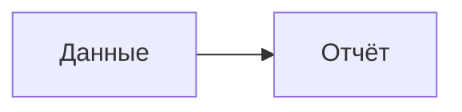
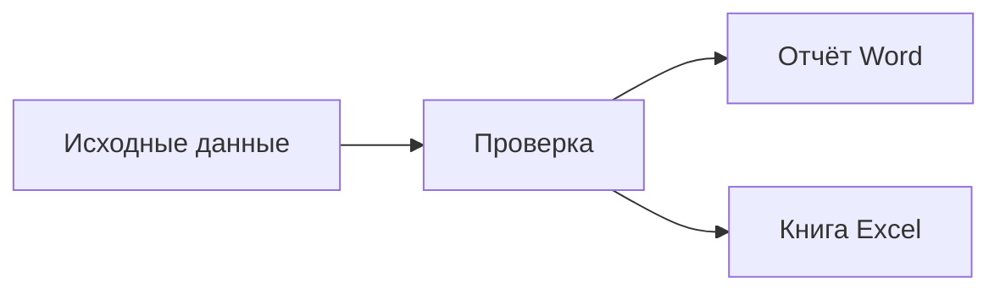
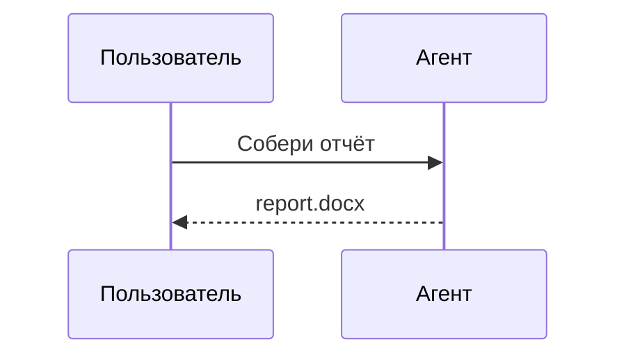

# Что чем рисовать

| Задача | Инструмент |
| --- | --- |
| Числа, доли, динамика, сравнение | `platform_render_chart` |
| Блок-схема, процесс, последовательность | `platform_render_mermaid` |
| Структура классов, ER, состояния | `platform_render_mermaid` |
| План по датам, таймлайн, майндмэп | `platform_render_mermaid` |
| График внутри Excel | нативный `charts` в `workbook.json` |

Chart не умеет блок-схемы, sequence, ER, class, gantt, mindmap. Mermaid не
годится для точных числовых графиков с двумя осями, лог-шкалой и большими
рядами — это chart.

# В чате

График и схема показываются только отдельными блоками верхнего уровня.

```chart
{"type":"bar","title":"Обращения","labels":["янв","фев"],
 "datasets":[{"label":"план","data":[10,12]}]}
```



Не оборачивай ответ в ```markdown, не вкладывай блоки друг в друга и не вставляй
PNG-ссылки в чат: картинка в чате не откроется. В чате поле называется
`datasets`, не `series`.

# График (chart JSON)

Верхний уровень: `type`, `labels`, `datasets`, опционально `options`.
Поле называется `datasets`, не `series`.

Типы: `bar`, `line`, `pie`, `doughnut`, `radar`, `scatter`.

- горизонтальные столбцы — `"type":"bar"` + `"indexAxis":"y"` (типа `hbar` нет);
- площадь — `"type":"line"` + `"fill":true` у dataset (типа `area` нет);
- сглаживание — `"tension":0.3` у dataset;
- смешение столбцов и линий — `"type":"line"` или `"type":"bar"` у dataset;
- вторая ось — `"yAxisID":"y1"` и описание `options.scales.y1`;
- накопление — `options.scales.x.stacked` и `options.scales.y.stacked`;
- заголовок — `options.plugins.title.text`, но проще заголовком перед блоком.

```json
{"type":"bar","labels":["янв","фев","мар"],
 "datasets":[{"label":"план","data":[10,12,9]},{"label":"факт","data":[9,13,11]}]}
```

```json
{"type":"line","labels":["янв","фев","мар"],
 "datasets":[{"label":"Вызовы","data":[10,14,12],"fill":true,"tension":0.3},
             {"label":"Ошибки","data":[2,1,3],"yAxisID":"y1"}],
 "options":{"scales":{"y":{"position":"left"},"y1":{"position":"right","grid":{"drawOnChartArea":false}}}}}
```

```json
{"type":"bar","indexAxis":"y","labels":["Word","Excel","PDF"],
 "datasets":[{"label":"документы","data":[5,3,2]}]}
```

```json
{"type":"doughnut","labels":["Word","Excel","PDF"],
 "datasets":[{"label":"документы","data":[5,3,2]}]}
```

Радар требует `labels` и числовые ряды. Scatter — точки `{"x":1,"y":2}`;
для временных рядов бери `line`, а не `scatter`.

Не поддерживается: bubble, лог-шкала, точные проценты накопления, больше ~40
точек на ряд. Упрости данные или сделай таблицу.

# Схема (Mermaid)

Поддерживаются `flowchart`, `sequenceDiagram`, `classDiagram`,
`stateDiagram-v2`, `erDiagram`, `gantt`, `timeline`, `mindmap`, `journey`,
`quadrantChart`, `sankey-beta`, `pie`, `xychart-beta`.





Правила: короткие подписи (до 40 символов), без HTML-тегов, без внешних
картинок и ссылок, идентификаторы латиницей, текст в подписях — на языке
документа.

# Процесс

- Только показать в чате: сразу вставь блоки `chart`/`mermaid` в ответ, файлы
  не создавай.
- Нужны `.docx`/`.xlsx`: запиши исходник (`chart-1.json` или `diagram-1.mmd`),
  вызови `platform_render_chart`/`platform_render_mermaid`, проверь PNG и
  сошлись на него в markdown как ``.
- Ошибка рендера → исправь исходник один раз; повторная ошибка → таблица.
